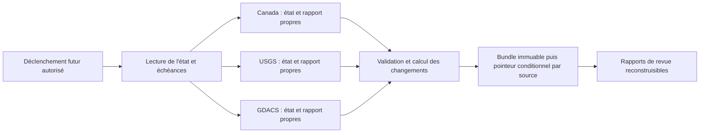

# TripGuidely V3 — Phase 4 : fondation de surveillance autonome

Date de revue : 2026-10-24 (America/Toronto). **Activation de surveillance : NEEDS DECISIONS.**
Phase 4A : le propriétaire autorise la revue finale, les tests, un commit ciblé des
trois fichiers Phase 4, le push de la branche existante et une PR Draft de validation.
Cette autorisation ne concerne ni fusion, ni déploiement, ni service AWS, ni permission
d'écriture supplémentaire, ni collecte planifiée, ni publication d'alertes.

## 1. État audité et décision d'architecture

Worktree réutilisé : `feat/global-travel-intelligence-v3-automation`.
HEAD et dernier `origin/main` vérifié :
`cd59d017c5fc091e834575c1a2b125e74ffd1ea7`, fusion de #62, après #60 et #61.
Les anciens worktrees et les changements Disney du checkout principal sont conservés.

Modules examinés : adaptateurs Canada (`providers.py`), USGS (`usgs.py`), GDACS
(`gdacs.py`), registres/configurations, CLI, moteur, rapprochement, validation,
rapports et `LocalStateStore`. Les trois workflows versionnés ont été examinés.

**Architecture approuvée par le propriétaire :** une orchestration commune, trois partitions d'état
indépendantes, un stockage objet privé versionné avec mises à jour conditionnelles,
un journal durable lié à chaque état et des rapports reconstruisibles. Amazon S3 et
Google Cloud Storage sont comparés ci-dessous ; S3 est recommandé pour qualification,
sans sélection définitive. Aucun compte, bucket, SDK, rôle ou abonnement n'a été créé.
Orientations Phase 4A approuvées : S3 premier candidat à qualifier, région
`ca-central-1` à évaluer, budget cible maximum 5 USD/mois sans autorisation de dépense,
90 jours avec exceptions d'audit justifiées jusqu'à 365 jours. Le fournisseur n'est
pas définitivement engagé et les permissions d'un futur writer ne sont pas accordées.
Si aucun stockage externe n'est approuvé, rester en rejeu local ; ne pas remplacer
la durabilité par un cache Actions ou une chaîne d'artifacts.



Le diagramme décrit une cible à développer, pas un système déjà déployé.
Les seuls fichiers ajoutés ici sont ce rapport et
`tests/test_v3_automation_foundation.py` ; le workflow de validation V3 est adapté
pour la validation offline de la PR, sans collecte ni déploiement. Le petit coordinateur de cette suite est
un exemple de test injectant des fixtures : ce n'est ni un collecteur ni une CLI de production.

### Adaptateurs et limites conservées

| Profil | Données réellement couvertes | Limites à conserver |
| --- | --- | --- |
| Canada, défaut inchangé | Index national EN ; FR, GB, IT, US ; audience canadienne | Avis national, pas incident urbain confirmé ; ne pas généraliser à toutes les nationalités. |
| USGS, sélection explicite | Séismes M4.5+ des sept derniers jours | Flux glissant incomplet ; révisions et alias ne prouvent pas un impact touristique ; drapeau tsunami non assimilé à une alerte active. |
| GDACS, sélection explicite | Cache `events4app`, EQ/TC/FL/VO/DR/WF qualifiés | Sélection partielle ; certaines catégories peuvent manquer ; pas de pagination SEARCH/backfill ; horodatages sans offset et génération inconnue conservés tels quels. |

Les trois transports existants font un GET anonyme fixe, sans redirection ni retry :
2 000 000 octets maximum, timeout socket de 15 s, budget écoulé de 30 s contrôlé
entre lectures. Ce budget n'interrompt pas strictement une lecture bloquée.
Les URL de détail fournies ne sont pas suivies. Aucun GET de collecte n'a été exécuté
pendant cette phase ; seule la documentation officielle a été consultée en ligne.

## 2. Stockage durable : comparaison et choix

| Solution | Durabilité / récupération | Droits et confidentialité | Coûts / conflits | Avis |
| --- | --- | --- | --- | --- |
| Cache Actions | Éviction après inactivité ou pression de capacité ; un cache peut manquer sans préavis. Aucune garantie de restauration. | Le token de contenu peut rester en lecture ; les caches ne doivent contenir aucun secret. | Capacité partagée avec les autres usages ; clés immuables, restore par préfixe insuffisant pour choisir une version autoritaire. | Accélérateur optionnel, jamais source d'état. |
| Artifacts Actions | Archives bornées par rétention ; suppression/expiration d'un run ou artifact peut rompre toute continuité. | Upload via service runtime Actions ; lecture inter-runs via `actions: read` si nécessaire. Sur dépôt public, ne pas les traiter comme privés. | Quotas/stockage, dépendance au service Actions ; pas de CAS sur un pointeur « dernier état ». | Rapports de revue temporaires, pas base de données. |
| Branche Git technique du dépôt du site | Historique versionné tant que références/objets existent ; clone de sauvegarde nécessaire. Pas de sauvegarde indépendante implicite. | Exige `contents: write`, portée dépôt, pas seulement branche ou chemin. JSON/historique publics. | Conflits de push, croissance du dépôt/clones, suppression/force-push, effets possibles de hooks/déploiements. | Déconseillé sur ce dépôt, particulièrement avec main non protégé. |
| Dépôt Git d'état distinct | Isole les droits du dépôt du site ; historique et récupération Git possibles. | GitHub App limitée au dépôt d'état, writer `contents: write` uniquement là ; droits et protections à approuver. | Toujours Git, conflits et croissance ; sauvegarde, visibilité et rétention à définir. | Alternative si le propriétaire refuse un stockage objet. |
| Stockage objet privé versionné | États immuables, versionnement, CAS du pointeur et sauvegarde séparée ; récupération explicite. | Identité courte durée et préfixes restreints ; aucun `contents: write` sur le site. | Frais de stockage/requêtes, mauvaise règle de cycle de vie ou IAM, conflits CAS à traiter. | Cible recommandée après autorisation et qualification. |

Les [règles de cache GitHub](https://docs.github.com/en/actions/reference/workflows-and-actions/dependency-caching)
indiquent une éviction après plus de sept jours sans accès, une capacité par défaut
de 10 GB et une exposition possible des caches de la branche de base aux PR/forks.
Les limites supplémentaires peuvent être payantes. **Le cache n'est pas un stockage durable garanti.**

Les [artifacts](https://docs.github.com/en/actions/how-tos/manage-workflow-runs/download-workflow-artifacts)
sont téléchargeables par des utilisateurs connectés disposant de l'accès en lecture.
La [rétention d'un dépôt public](https://docs.github.com/en/repositories/managing-your-repositorys-settings-and-features/enabling-features-for-your-repository/managing-github-actions-settings-for-a-repository)
est bornée à 90 jours. Le réglage effectif de rétention de ce dépôt n'a pas été obtenu ;
ne pas le confondre avec la valeur par défaut documentée ni avec les 14 jours explicites de Paris V2.

### Pourquoi contents: write est risqué

Un `GITHUB_TOKEN` autorisé à écrire le contenu n'est pas limité à `state/*.json`.
Une compromission du job, une injection shell ou un checkout non fiable pourrait
modifier des pages, le code ou d'autres références permises. Un push Git n'est pas
une garantie qu'aucun autre déploiement/hook ne réagira. Une branche publique conserve
aussi les anciennes versions : retirer un fichier courant ne retire pas son historique.
Une alternative Git exigerait un commit parenté au SHA lu et une mise à jour non
fast-forward refusée, sans force-push, plus sauvegardes et protections réelles.
Les [permissions du token](https://docs.github.com/en/actions/tutorials/authenticate-with-github_token)
doivent être minimales par job. Aucun droit d'écriture n'a été attribué ici.

### Comparatif vérifiable : Amazon S3 et Google Cloud Storage

Périmètre comparable : buckets privés, classe Standard, objets JSON de petite taille,
écriture simple (pas multipart), API native, région US-East-1 pour S3 et US-East1 pour GCS.
Ces régions servent au chiffrage ; aucune résidence géographique finale n'est décidée.

| Critère | Amazon S3 Standard | Google Cloud Storage Standard régional |
| --- | --- | --- |
| Création conditionnelle | `If-None-Match: *` sur PUT ; 412 si une version courante existe. | `ifGenerationMatch=0` ; 412 si une version vivante existe. |
| Remplacement conditionnel | `If-Match: <ETag lu>` ; conflit 412, parfois 409 ; aucune écriture aveugle en fallback. | `ifGenerationMatch=<generation lue>` ; 412 si la génération a changé. Ne pas substituer la seule metageneration. |
| Concurrence et atomicité | Cohérence forte des objets ; mise à jour atomique d'une clé. L'ETag n'est ni un identifiant de version ni un hash SHA256 garanti. | Cohérence forte des objets ; atomicité d'un objet. Le numéro de génération évite de confondre une réécriture avec l'ancien objet. |
| Versions / restauration | Versioning conserve les versions remplacées ; restauration par copie d'une version validée. Refuser DeleteObject/DeleteObjectVersion au writer. | Object Versioning conserve les versions non courantes ; restauration par copie avec préconditions. Soft delete est une protection distincte, à combiner si approuvée. |
| Droits minimaux | `s3:GetObject` et `s3:PutObject` sur les seuls préfixes autorisés ; lecture d'anciennes versions réservée au rôle de restauration si nécessaire. | `storage.objects.get/create` sur les bundles ; remplacer le contenu d'un pointeur exige aussi `storage.objects.delete`, limité aux seuls noms de pointeurs. Pas de rôle Storage Admin pour le writer. |
| Authentification Actions | OIDC GitHub vers STS, rôle à courte durée lié au dépôt/ref ou environnement protégé. | Workload Identity Federation GitHub ; accès direct ou impersonation d'un service account dédié, sans clé JSON permanente. |
| Disponibilité contractuelle | SLA S3 Standard : crédits sous 99,9 %, soumis aux exclusions/conditions du SLA. | SLO Standard régional US : 99,9 % ; multi/dual-région 99,95 %, à un autre tarif. |
| Journalisation | CloudTrail management ne suffit pas : activer les événements de données sur le bucket/prefixe ; facturation et stockage des logs séparés. | Admin Activity actif ; Data Access doit être explicitement activé. Les suppressions lifecycle ne sont pas suivies par ces logs : garder aussi un manifeste applicatif. |
| Risques spécifiques | ABA si le contenu du pointeur revient identique : inclure séquence monotone + identifiant d'engagement unique. Versioning ne protège pas d'un administrateur destructeur. | La permission de remplacement inclut une capacité de suppression du pointeur ; cloisonner son IAM. Soft delete/versioning augmentent la rétention facturée ; une suppression de bucket n'est pas protégée par le seul versioning. |

Références des garanties : [préconditions S3](https://docs.aws.amazon.com/AmazonS3/latest/userguide/conditional-writes.html),
[application des préconditions par politique S3](https://docs.aws.amazon.com/AmazonS3/latest/userguide/conditional-writes-enforce.html),
[cohérence S3](https://docs.aws.amazon.com/AmazonS3/latest/userguide/Welcome.html),
[préconditions GCS](https://docs.cloud.google.com/storage/docs/request-preconditions),
[cohérence GCS](https://docs.cloud.google.com/storage/docs/consistency).
Les deux garanties sont par objet, jamais une transaction atomique multi-objets.
L'absence de version courante ne constitue pas une autorisation de réinitialiser un store déjà initialisé.

Pour les droits et la récupération : [versioning S3](https://docs.aws.amazon.com/AmazonS3/latest/userguide/versioning-workflows.html),
[versioning GCS](https://docs.cloud.google.com/storage/docs/object-versioning),
[permissions GCS](https://docs.cloud.google.com/storage/docs/access-control/iam-permissions),
[soft delete GCS](https://docs.cloud.google.com/storage/docs/soft-delete).
Le writer ne gère ni IAM, ni lifecycle, ni les sauvegardes. Les droits supplémentaires
de restauration sont confiés à un rôle humain distinct, jamais à la collecte courante.

Authentification : [OIDC AWS](https://docs.github.com/en/actions/how-tos/secure-your-work/security-harden-deployments/oidc-in-aws)
et [WIF Google](https://docs.cloud.google.com/iam/docs/workload-identity-federation-with-deployment-pipelines).
Dans les deux cas, une future demande `id-token: write` serait nécessaire et doit
recevoir une autorisation séparée. Aucune permission OIDC ni identité externe n'est créée ici.

Disponibilité et logs : [SLA S3](https://aws.amazon.com/s3/sla/),
[SLA GCS](https://cloud.google.com/storage/sla),
[CloudTrail S3](https://docs.aws.amazon.com/AmazonS3/latest/userguide/enable-cloudtrail-logging-for-s3.html),
[Audit Logs GCS](https://docs.cloud.google.com/storage/docs/audit-logging).
Un SLA donnant droit à crédit n'est pas une garantie de continuité du monitor.

**Recommandation : qualifier d'abord S3**, parce que le writer peut modifier le pointeur
sans droit de suppression et qu'une bucket policy peut exiger les préconditions.
GCS reste techniquement compatible, avec un CAS de génération particulièrement clair,
et un coût Standard légèrement inférieur dans les régions de référence. L'écart de
coût ne justifie pas de sacrifier le cloisonnement des privilèges. Le choix final
reste suspendu à la région, aux contraintes de résidence, au budget approuvé et aux
tests contractuels en sandbox autorisée ; la documentation n'est pas un essai cloud réel.

## 3. Contrat de persistance cible et pannes

### Limites du backend local actuel

Le backend V3 possède des générations JSON immuables, hash de contenu/chaîne,
pointeur CURRENT atomique, verrou exclusif, comparaison de version attendue et
récupération explicite. Il refuse les liens, chemins dans un checkout, états corrompus,
conflits et reculs d'horloge ; il conserve le dernier contenu valide lors d'une panne source.

Mais le disque d'un runner éphémère disparaît. Le verrou local protège le commit,
**pas toute la collecte ni plusieurs machines**. Les plafonds restent 1 000 événements,
1 000 générations et 10 MB par état. Chaque passage, même inchangé ou en panne source,
peut produire une génération. À cadence constante, 1 000 générations représentent
environ 41,7 jours pour Canada horaire, 10,4 jours pour USGS toutes les 15 minutes,
20,8 jours pour GDACS toutes les 30 minutes. D'autres limites peuvent être atteintes avant.
La validation de toute la chaîne à chaque lecture grandit avec l'historique.
Copier ce répertoire en artifact à chaque run ne corrige ni la croissance ni l'expiration.

L'état et les rapports locaux JSON/Markdown ne forment pas une transaction unique.
Un crash après commit peut perdre le rapport des changements ; une génération valide
orpheline peut rester avant le basculement du pointeur. Les tests de cette phase
reproduisent ces cas. **Un backend cloud n'est donc pas un simple remplacement
transparent de LocalStateStore.** Le contrat applicatif doit aussi évoluer.

### Transaction proposée, à implémenter après choix du backend

Une partition par `source_id` et version de configuration, sans réunir arbitrairement
les anciens profils. Chaque engagement comprend état, changements, diagnostics, provenance,
hashes, version précédente, identifiant d'exécution, code révisé, dernières tentatives/réussites
et prochaine échéance. Les dates techniques ne deviennent pas des confirmations humaines.

1. Lire le pointeur durable et vérifier schéma, hash, configuration, version et horloges.
   Un pointeur manquant après initialisation bloque la source : ne jamais redémarrer vide
   en prétendant qu'il s'agit de nouvelles catastrophes. Bootstrap uniquement sur décision explicite.
2. Réserver l'exécution si le contrat de verrou distribué le prévoit, avant l'appel source.
   Calculer l'éligibilité et respecter le cooldown persisté. Un échec de lecture du stockage
   interdit la collecte ; aucune collecte « pour rien » sans état de comparaison récupérable.
3. Lire une source autorisée, valider le batch entier, comparer au dernier état.
   Préparer le bundle état + journal de changements + données nécessaires aux rapports.
4. Écrire le bundle sous un nom immuable avec création conditionnelle ; vérifier son intégrité.
   Modifier le pointeur seulement si son ETag/version correspond à celui lu. Un conflit
   refuse l'écriture ; recharger et recalculer, sans écraser ni republier l'ancien candidat.
5. Le pointeur est le marqueur d'engagement. En cas de timeout de réponse, le relire :
   le même identifiant/hash signifie « déjà engagé » ; sinon signaler l'issue incertaine.
   Un hash assure l'intégrité, pas l'authenticité d'un writer compromis.
6. Générer les rapports à partir du bundle engagé. Si leur rendu échoue, reprendre ce
   rendu avec le même journal, sans nouvelle collecte et sans remplacer les changements
   originaux par le résultat vide d'un rejeu.

[S3 permet des écritures conditionnelles](https://docs.aws.amazon.com/AmazonS3/latest/userguide/conditional-writes.html)
avec `If-None-Match` pour créer et `If-Match` pour comparer un ETag ; les conflits
409/412 sont des issues à traiter, pas des autorisations d'écraser.
Le [versionnement](https://docs.aws.amazon.com/AmazonS3/latest/userguide/Versioning.html)
aide à récupérer d'un écrasement mais n'est ni une sauvegarde indépendante ni une
protection contre la suppression définitive de versions par une identité autorisée.

Prévoir checkpoints vérifiés et archives immuables partitionnées : ne plus relire
toutes les générations à chaque polling. Conserver un index durable des identifiants,
dernières révisions et hashes pour la déduplication après archivage.
Déplacer une observation vers une archive ne signifie ni la résoudre ni la supprimer.
La nouvelle politique de taille/rétention et la migration de schéma doivent être qualifiées
avant d'approcher les plafonds ; aucun reset/éviction automatique n'est accepté.

Proposition à approuver : historique opérationnel 90 jours, sauvegarde quotidienne
séparée et restauration testée mensuellement. Les éléments nécessaires aux états/index
courants ne sont jamais expirés par une règle aveugle. Objectifs proposés : conserver
tout engagement confirmé ; récupération depuis sauvegarde quotidienne avec perte
potentielle jusqu'à 24 h si le stockage primaire est détruit ; RTO de 24 h après
intervention humaine. Ce sont des objectifs à valider, pas des garanties acquises.
Une sauvegarde inaccessible au writer limite le rayon d'une compromission.
Aucun verrou résiduel n'est supprimé automatiquement : une future lease à durée limitée
exige un jeton de fencing et une vérification au commit ; le seul TTL n'empêche pas un writer ancien d'écrire.

## 4. Plan d'exécution automatique — inactif

Préparer ultérieurement un workflow dédié, séparé de Paris V2 et des tests :
Ubuntu 24.04, Python 3.12, actions officielles épinglées, checkout sans credentials
persistants, timeouts explicites, aucun script ni état restauré exécuté comme du code.
Le premier palier sera manuel et shadow, avec références de code approuvées ; le
palier périodique nécessitera une nouvelle autorisation. Aucun YAML de collecte n'est ajouté ici.

Un dispatcher commun évalue les trois profils ; chaque source a un résultat, un état,
une cadence et un verrou propres. L'échec GDACS ne bloque pas Canada ou USGS.
Le profil combiné `gdacs-usgs --live` reste interdit ; le rapprochement est une étape
de lecture des observations engagées séparément, conservant leurs versions et provenances.

Le verrou de groupe doit couvrir manuel et périodique pour une même source.
`cancel-in-progress: false` évite l'annulation d'un writer en cours, mais
[la concurrence Actions](https://docs.github.com/en/actions/how-tos/write-workflows/choose-when-workflows-run/control-workflow-concurrency)
ne remplace pas le CAS durable et ne garantit pas l'exécution de chaque créneau.
Pas de boucle de rattrapage de tous les créneaux manqués : une observation courante,
un diagnostic de trou de couverture et aucune histoire intermédiaire inventée.

Les [exécutions planifiées GitHub](https://docs.github.com/en/actions/reference/workflows-and-actions/events-that-trigger-workflows)
peuvent être retardées ou abandonnées ; les workflows publics peuvent être désactivés
après 60 jours d'inactivité. Préférer des minutes décalées du début d'heure, surveiller
la dernière exécution et prévoir un contrôle humain indépendant de GitHub.
Une exécution périodique n'est pas une surveillance temps réel.

## 5. Fréquences, quotas et erreurs

Ces cadences sont des **propositions prudentes**, pas des quotas accordés par les fournisseurs.

| Source | Proposition initiale | Maximum nominal de GET/jour | Justification et contraintes |
| --- | --- | --- | --- |
| Canada | 60 minutes | 24 | Index de conseils continuellement mis à jour ; pas de fréquence fixe contractuelle qualifiée. Un GET commun pour les quatre pays pilotes. |
| USGS | 15 minutes | 96 | Flux hebdomadaire rafraîchi chaque minute selon sa documentation ; ce polling ne récupère pas toutes les révisions intermédiaires. |
| GDACS | 30 minutes | 48 | Préférer la collection en cache conseillée par GDACS ; la cadence ne rend pas ce cache exhaustif et ne qualifie pas sa fraîcheur scientifique. |

Total nominal : 168 GET/jour, 5 040 par 30 jours, hors erreurs et lectures de stockage.
Un dispatcher toutes les 15 minutes ferait au plus 2 880 exécutions/mois ;
il ne doit pas appeler toutes les sources à chaque fois. Les prochaines échéances
s'appuient sur l'état durable, pas uniquement sur les champs d'une expression cron.
Aucun quota numérique contractuel par minute/jour n'a été confirmé pour ces trois
endpoints dans les références consultées. Une réponse 200 ou un accès gratuit ne
donne pas un droit de polling illimité.

Politique cible à développer : pas de retry immédiat en rafale ; timeout/5xx reportent
la prochaine tentative par backoff exponentiel à partir de la cadence, avec jitter
positif et plafond de six heures. 429 impose au minimum le `Retry-After` validé,
même s'il dépasse ce plafond ; une valeur au-delà de 24 h conduit à une pause pour revue.
401/403, redirection, schéma inconnu ou changement de conditions suspendent la source
pour diagnostic. Les transports actuels n'exposent pas un contrat de headers de backoff :
il faudra l'ajouter et le tester, sans relâcher leurs limites. Aucun contournement
de restriction d'accès, fournisseur miroir ou URL fournie par un événement.

Conserver des marqueurs distincts : tentative, réception, dernière donnée structurellement
valide, génération source lorsqu'elle existe, échéance de revue humaine et dernier commit
durable. Une source indisponible peut produire un engagement valide de diagnostic tout en
restant indisponible ; contrôler le rapport et la persistance, pas uniquement un statut de job.
Ne pas rafraîchir une approbation humaine par polling. Toute absence, expiration ou
interruption reste une limite de vérification, jamais une conclusion de sécurité.

### Conditions et attribution

- Canada : le [catalogue officiel](https://open.canada.ca/data/en/dataset/bef2ebb3-ca9a-485f-aaff-5dc36eb89426)
  indique une mise à jour continue et avertit que sa date de fiche n'est pas celle des données.
  La [Licence du gouvernement ouvert](https://open.canada.ca/en/open-government-licence-canada)
  permet la réutilisation sous conditions d'attribution, sans approbation officielle implicite
  ni droits généraux sur logos/données personnelles ou contenus tiers.
  Les accès directs à ces pages ont renvoyé 403 dans l'outil de lecture ; leurs extraits
  indexés officiels ont été consultés, sans contourner le blocage. Revalider les conditions avant activation.
- USGS : [format et rafraîchissement](https://earthquake.usgs.gov/earthquakes/feed/v1.0/geojson.php)
  qualifiés ; crédit « U.S. Geological Survey ». Les [droits USGS](https://www.usgs.gov/information-policies-and-instructions/copyrights-and-credits)
  distinguent les données produites par USGS du contenu tiers : ne pas étendre le domaine public à tout média.
- GDACS : le [guide v2](https://www.gdacs.org/Documents/2025/GDACS_API_quickstart_v2.pdf)
  recommande les collections en cache et demande le crédit
  « Global Disaster Awareness and Coordination System, GDACS ».
  Les [conditions de mars 2025](https://www.gdacs.org/Documents/2025/GDACS_Terms_of_use_Mar_25.pdf)
  décrivent des estimations automatiques incertaines, sans garantie de complétude/actualité,
  devant être validées et ne remplaçant pas les autorités d'alerte locales/nationales.
  L'accès gratuit ne vaut pas licence universelle des données/cartes/médias amont.

Les rapports conservent endpoint, source, identifiant/épisode, version d'adaptateur,
hash de payload, heure disponible, licence et attribution. Pas de copie brute persistante
par défaut avant décision de rétention/droits ; pas d'invention de morts, dégâts,
évacuations ou impacts hôtels. Ni proximité ni pays commun ne prouvent un impact urbain.
Un lien GDACS/USGS exige une identité officielle explicite et ne crée pas une confirmation indépendante.

## 6. Permissions et sécurité GitHub

Lecture API effectuée le 2026-10-24, sans changement :
- `main.protected=false` ; API protection : 404 « Branch not protected ».
- Rulesets du dépôt : [] ; règles effectives sur main : [] ; aucun contrôle requis imposé.
- Actions activé ; `allowed_actions=all`, `sha_pinning_required=false`.
- Permission workflow par défaut : `read` ; approbation de PR par Actions désactivée.
- Dépôt public. Les réglages de facturation/plan, rétention effective et politiques
  externes au résultat des API n'ont pas été déduits.

Ces lectures ont utilisé `gh api` en GET pour les paramètres absents du connecteur.
La réponse 404 de protection et les listes de règles vides ne sont pas prises pour
des protections actives. La lecture est renouvelée pour cette revue de stockage.

| Opération future | Permissions envisagées | Statut |
| --- | --- | --- |
| Tests offline / checkout | `contents: read` | Déjà en place ; inchangé. |
| Rapports artifacts du même run | Service runtime Actions ; contenu en lecture | À qualifier ; aucune création dans cette phase. |
| Restauration artifacts d'un autre run | `actions: read` si API authentifiée nécessaire | À approuver si choisie ; pas de `actions: write` pour supprimer des historiques. |
| Stockage objet via OIDC | `contents: read`, `id-token: write` au seul job approuvé | Nouvelle permission, donc autorisation explicite requise ; non attribuée. |
| Branche technique dans le site | `contents: write` | Déconseillé et non autorisé. |
| Dépôt d'état distinct | Installation GitHub App au seul dépôt d'état, contenu en écriture | Alternative à décider ; aucune App créée. |

[OIDC AWS](https://docs.github.com/en/actions/how-tos/secure-your-work/security-harden-deployments/oidc-in-aws)
nécessite `id-token: write` pour obtenir une identité courte durée. Ce droit n'écrit
pas le contenu GitHub, mais permet l'obtention des droits externes accordés au rôle.
Restreindre audience et sujet au dépôt/identifiants réels et à la référence ou à
l'environnement protégé attendu ; vérifier le format de claims effectivement utilisé.
Ne pas supposer qu'un sujet d'environnement impose aussi main : ajouter sa restriction
de branches. Jamais de wildcard autorisant PR/forks ou de secrets longue durée par défaut.

IAM cible S3 : lecture/écriture conditionnelle aux seuls préfixes source autorisés ;
pas de suppression de versions, ACL publiques, politique de bucket, création de rôle
ou accès aux sauvegardes. Pour GCS, le droit de suppression indispensable au remplacement
est limité aux seuls pointeurs, exclu des bundles et archives ; cette exception doit être
qualifiée et approuvée explicitement. Configurer hors du writer versionnement, chiffrement,
blocage public et sauvegarde. Des budgets alertent mais ne constituent pas tous un arrêt dur.
Aucune recherche ni lecture de credentials AWS locaux n'a été faite.

Avant tout writer externe, demander des protections main : PR obligatoire, revue,
contrôles V3 et audit requis, restriction des push directs/bypass et force-push,
revue des workflows/configurations sensibles. Prévoir un contrôle requis toujours
éligible pour éviter qu'un filtre de chemins laisse une PR documentation en attente.
Examiner aussi les règles d'actions autorisées et épingler les références mutables.
Ce sont des recommandations ; aucun réglage n'a été changé.

### Règles exactes proposées pour main — à appliquer seulement après accord

| Paramètre | Valeur cible / contrôle |
| --- | --- |
| Cible | `refs/heads/main`, protection active, applicable aux administrateurs (`enforce_admins=true` en protection classique). |
| PR obligatoire | 1 approbation humaine ; `dismiss_stale_reviews=true`, `require_last_push_approval=true`, `required_conversation_resolution=true`. Pas d'auto-approbation par Actions. |
| Revue des fichiers sensibles | `require_code_owner_reviews=true` après désignation d'un mainteneur et création approuvée de CODEOWNERS pour `.github/workflows/`, `scripts/travel_intelligence/`, CLI et configurations V3. Aucun propriétaire fictif n'est ajouté ici. |
| Tests requis | `offline-tests` et `audit`, application GitHub Actions ID `15368` ; noms/app vérifiés sur les check-runs existants. `strict=true` : branche à jour avec main. |
| Bypass | Aucune App, bot ou équipe autorisée à bypasser PR/revue/contrôles ; inclure administrateurs dans l'application de la règle. |
| Push directs | Aucune exception au passage par PR. En organisation, restreindre les acteurs de mise à jour aux mainteneurs humains désignés ; aucune App de collecte. Leur capacité de fusion n'autorise pas à contourner les checks. |
| Force-push / suppression | `allow_force_pushes=false`, `allow_deletions=false`. Aucune branche technique de stockage dans le dépôt du site. |
| Token Actions | Défaut lecture conservé ; CI : uniquement `contents: read`. Aucune permission contents/actions/PR en écriture pour le monitoring. |
| Actions autorisées | Recommander actions officielles nécessaires uniquement et SHA complets ; qualifier l'épinglage des tags mutables de l'audit dans un changement séparé approuvé. |
| Secrets | Pas de PAT ni clé cloud longue durée par défaut ; OIDC futur à durée courte, sujet/audience/IDs exacts, environnement limité à main. Aucun secret dans état, cache, artifact public ou log. |

Les [protections de branches](https://docs.github.com/en/repositories/configuring-branches-and-merges-in-your-repository/managing-protected-branches/about-protected-branches)
doivent être réellement appliquées et testées ; une valeur dans ce tableau ne les configure pas.
Le workflow V3 local n'a plus de filtre de chemins sur les PR : une PR documentation
produira donc aussi `offline-tests`, évitant un contrôle requis éternellement en attente.
La règle requiert un relecteur humain autre que le dernier pousseur : si l'équipe n'en
dispose pas, le propriétaire doit en désigner un avant cette activation, pas créer un bypass bot.
Ne pas activer `require_code_owner_reviews` comme preuve de revue propriétaire avant
qu'un CODEOWNERS valide et des personnes habilitées existent.

Pour les futurs credentials externes : isoler les permissions par job/environnement,
ne pas les exposer aux PR/forks, exclure `pull_request_target` et les artifacts de PR
des jobs writer, bloquer les URLs/refs libres. Les seuls identifiants publics de rôle/bucket
seront des variables non secrètes ; jamais de JWT, clé ou payload d'erreur dans un rapport.
Prévoir procédure de révocation de la fédération, rotation si un secret est exceptionnellement
approuvé, et audit d'accès. Aucun secret ni règle n'est créé dans cette mission.

### Procédure de protection à soumettre au propriétaire

1. Dans Settings > Branches, préparer une protection classique pour le motif exact
   `main` (ou un ruleset de branche équivalent ciblant `refs/heads/main`, sans doublonner
   deux politiques contradictoires). Nommer les mainteneurs/relecteurs humains avant application.
2. Activer Require a pull request before merging, une approbation, annulation des
   approbations après nouveaux commits, approbation du dernier push par une autre personne
   et résolution des conversations. Préparer CODEOWNERS dans un changement distinct
   autorisé avant d'exiger sa revue ; ce fichier n'est pas ajouté à la PR Phase 4A.
3. Exiger les checks `offline-tests` et `audit` de l'App GitHub Actions (ID 15368),
   avec branche à jour avant fusion. La CI V3 couvre maintenant les PR documentation
   également ; vérifier les noms exacts des checks du nouveau run avant d'enregistrer la règle.
4. Appliquer les règles aux administrateurs et désactiver les bypass ; interdire les
   force-push et suppressions. Restreindre les acteurs aux mainteneurs autorisés, sans
   exception App/bot. Une restriction d'acteurs ne remplace pas l'exigence de PR.
5. Dans Settings > Actions > General, conserver le token par défaut en lecture et
   l'approbation de PR par Actions désactivée. Préparer l'allowlist d'actions et les SHA
   complets ; traiter les tags mutables existants de l'audit dans une autorisation séparée.
6. Vérifier par lecture API `branches/main`, `branches/main/protection` et
   `rules/branches/main` que les contrôles/bypass/acteurs effectifs correspondent au
   tableau. Contrôler une PR de validation sans fusion ; ne pas tester un push direct
   sur main ou changer une permission sans autorisation explicite.
7. Avant un writer externe, refaire la revue des identités et secrets : aucun
   `contents: write` pour V3, rôle cloud strict, pas de secrets longue durée, environnement
   limité à main. L'ajout futur de `id-token: write` reste une demande distincte.

Cette procédure est documentaire. Toutes les lectures de cette mission confirment
encore main non protégé ; aucun écran Settings ou endpoint de modification n'est utilisé.

### Workflows : état actuel et préparation locale

- V3 offline : Ubuntu 24.04/Python 3.12, `contents: read`, actions officielles épinglées,
  production main inchangée (129 tests). Copie locale préparée : PR vers main sans
  filtre de chemins + manuel, 148 cas exacts et zéro skip Linux ; aucune collecte V3.
- Paris V2 : workflow déjà actif et planifié `23 5 * * *`, garde/tests, monitoring
  existant sur main, cache et artifacts 14 jours, `contents: read`. Inchangé ;
  son existence ne doit pas être décrite comme un nouveau schedule V3.
- Site audit : PR + manuel, `contents: read` ; checkout/setup-python référencés
  par tags v7 mutables, risque de chaîne d'approvisionnement à corriger dans une phase autorisée.
- Workflow Pages dynamique présent : aucun lancement ou changement par cette mission.

Les principes de [sécurité Actions](https://docs.github.com/en/actions/reference/security/secure-use)
imposent de traiter source, état restauré, paramètres et code PR comme non fiables.
Ne jamais exécuter un artifact, importer un module distant ou interpoler du texte source
dans le shell. Pas de writer sur `pull_request_target`, `workflow_run` d'une PR,
branche arbitraire ou événements non approuvés. Les rapports sensibles restent privés ;
un artifact du dépôt public ne constitue pas une boîte de revue confidentielle.

## 7. Coûts et volumes

Aucune dépense ni souscription engagée. Estimations de conception en USD, hors taxes,
à revalider selon région, plan réel, rétention et volume avant toute autorisation.

### Tarifs de référence et modèle reproductible

La comparaison US ci-dessous est conservée comme référence entre fournisseurs.
**Le budget de candidature AWS Phase 4A utilise désormais ca-central-1, détaillé
dans la sous-section régionale suivante ; ne pas réutiliser les tarifs US pour Montréal.**

| Unité hors remises/free tier | S3 Standard, us-east-1 | GCS Standard, us-east1, namespace plat |
| --- | --- | --- |
| Stockage moyen | 0,023 USD/GB-mois | 0,020 USD/GiB-mois nominal ; tarification horaire affichée à 0,000027397/GiB-h. |
| 1 000 écritures | 0,005 USD (PUT) | 0,005 USD (classe A) |
| 1 000 lectures | 0,0004 USD (GET/HEAD) | 0,0004 USD (classe B) |

Sources primaires : [exemple AWS US-East-1](https://docs.aws.amazon.com/solutions/latest/live-streaming-on-aws-with-amazon-s3/cost-example-1.html),
[tarification S3](https://aws.amazon.com/s3/pricing/),
[tarif GET/HEAD S3 confirmé par AWS](https://aws.amazon.com/blogs/storage/run-spark-31-faster-and-optimize-compute-costs-with-amazon-s3-express-one-zone-on-amazon-emr/),
[exemple Google us-east1](https://cloud.google.com/storage/pricing-examples)
et [barème GCS](https://cloud.google.com/storage/pricing).
Les régions proposées ne sont pas encore sélectionnées. Vérifier le devis régional
et les unités de facturation à la souscription ; ne pas compter de crédit promotionnel.

Hypothèses : 168 collectes/jour, 5 040/30 jours, bundle complet moyen de 1 MiB,
90 jours roulants, deux copies séparées (primaire + sauvegarde indépendante).
Régime stabilisé : `168 * 90 / 1024 = 14,765625 GiB` par copie, soit 29,53125 GiB.
Prévoir trois écritures par collecte et par copie (bundle, pointeur, provision pour
index/contrôle), soit 30 240 écritures/mois, et 10 080 lectures/mois. C'est un modèle
de dimensionnement, pas le nombre d'appels mesuré d'un backend déjà implémenté.

| Poste mensuel au régime 90 jours | S3 | GCS |
| --- | --- | --- |
| Stockage primaire + copie | environ 0,679 USD | environ 0,591 USD |
| 30 240 écritures | 0,1512 USD | 0,1512 USD |
| 10 080 lectures | 0,004032 USD | 0,004032 USD |
| Sous-total objets/requêtes | **environ 0,835 USD** | **environ 0,746 USD** |
| Provision de conception pour réseau, logs et petites exceptions | 2 USD | 2 USD |
| Prévision initiale arrondie | **3 USD/mois** | **3 USD/mois** |

La provision de 2 USD est une marge choisie, pas un tarif ni une garantie. Elle doit
être remplacée par un calcul de transferts réels (runner GitHub hors cloud, sauvegarde,
restaurations), logs et emplacement de backup avant activation. Les anciennes versions,
soft-deleted objects, métadonnées, retries et audits sont facturables. Exclure les options
fixes inutiles (NAT, clés KMS gérées par client, base SQL, CloudTrail Lake) du pilote.
À 10 MiB/bundle, le stockage seul atteint environ 295,31 GiB pour deux copies :
6,79 USD S3 ou 5,91 USD GCS, avant réseau/logs. La cible de 5 USD serait déjà dépassée.
La taille des bundles doit donc être mesurée avant toute activation.

Journalisation à budgéter : [CloudTrail data events](https://aws.amazon.com/cloudtrail/pricing/)
affiche 0,10 USD/100 000 événements de trail, hors livraison/stockage/analyse ; les
[Audit Logs GCS](https://docs.cloud.google.com/storage/docs/audit-logging) exigent
activation Data Access et budget d'ingestion/rétention. Ne pas considérer le journal
applicatif, le versionnement et les logs du fournisseur comme interchangeables.

[GitHub Actions](https://docs.github.com/en/billing/concepts/product-billing/github-actions)
documente la gratuité des minutes sur runners standards d'un dépôt public ; les runners
plus grands et le stockage au-delà des allocations ont leurs propres coûts.
Aucun artifact de stockage V3 n'est ajouté ici, aucune collecte ne consomme ces ressources.

**Budget proposé : 3 USD/mois, garde budgétaire à 5 USD/mois, hors travail humain.**
Ce n'est pas une autorisation de dépense. Prévoir alerte à 3 USD et pause avant dépassement
prévu de 5 USD, en conservant l'état et l'accès de restauration. Une alerte de facturation
n'est pas un coupe-circuit garanti ; le contrôle de volume doit être testé dans le writer.
Les preuves sous conservation exceptionnelle restent protégées pendant la pause.
Aucun budget, service payant ou plafond n'a été configuré.

### Phase 4A : qualification documentaire de S3 ca-central-1

Le candidat approuvé est Amazon S3 Standard dans Canada (Central), `ca-central-1`.
Aucun compte/bucket n'existe du fait de cette mission et aucun accès S3 authentifié
n'a été tenté. Le relevé ci-dessous provient de GET anonymes des catalogues tarifaires
publics AWS, pas d'une console, d'un compte de facturation ni d'un SDK configuré.

| Unité ca-central-1, USD hors taxes/remises | Tarif public vérifié | Usage / SKU de référence |
| --- | --- | --- |
| Standard, premiers 50 TB | 0,025 / GB-mois | `CAN1-TimedStorage-ByteHrs`, `9MDYGCA9S4SXXTJF` |
| PUT/COPY/POST/LIST | 0,0055 / 1 000 requêtes | `CAN1-Requests-Tier1`, `8EZXHUYH7B92R35H` |
| GET et autres requêtes Tier2 | 0,00044 / 1 000 requêtes | `CAN1-Requests-Tier2`, `56GRD53C8EEUF5SE` |
| Sortie Internet, première tranche payante 10 TB | 0,09 / GB, au-delà des franchises globales éventuelles | `AWS Outbound`, `CXWFSAS9ETSMBH2Y` |

Source S3 : [catalogue public régional](https://pricing.us-east-1.amazonaws.com/offers/v1.0/aws/AmazonS3/current/ca-central-1/index.json),
publication `2026-10-15T17:35:40Z`, version `20261015173540`, termes effectifs
au `2026-10-01`. SHA256 de la réponse qualifiée :
`5d7e1cf9d3ff2d5fce8db93a5b83e74899437cc4c52e29e8b3ab47388e575100`.
Sortie : [catalogue AWSDataTransfer régional](https://pricing.us-east-1.amazonaws.com/offers/v1.0/aws/AWSDataTransfer/current/ca-central-1/index.json),
publication `2026-09-16T13:22:08Z`, version `20260916132208`.
Le tarif MRAP de 0,0033/GB rencontré dans le catalogue S3 n'est pas le prix de sortie
Internet standard et n'est pas utilisé. Aucun crédit gratuit n'est présumé disponible.

Avec les mêmes hypothèses 1 MiB/bundle, 5 040 collectes/mois et deux copies sur 90 jours :

| Poste mensuel ca-central-1 | Calcul | Estimation USD |
| --- | --- | --- |
| Stockage deux copies | 29,53125 * 0,025 | 0,738281 |
| Écritures | 30 240 / 1 000 * 0,0055 | 0,166320 |
| Lectures | 10 080 / 1 000 * 0,00044 | 0,004435 |
| Sous-total stockage/requêtes | Somme des trois postes | **0,909036** |
| Provision de sortie Internet | 10 GB * 0,09, sans déduire de franchise | 0,900000 |
| Provision logs, métadonnées, révisions, exceptions et opérations de sauvegarde | Marge de conception à mesurer | 1,000000 |
| Total modèle régional | Somme, arrondie | **2,81 USD/mois, cible 3 USD** |

Le prix unitaire est vérifiable ; le total reste prévisionnel car aucune consommation
réelle n'est autorisée. Les logs d'accès ne sont pas gratuits par hypothèse : la provision
doit être remplacée par le nombre d'événements, octets, copies et durée réels lors de
la qualification autorisée. Ne pas ajouter de frais fixes KMS/NAT/CloudTrail Lake au pilote.
Le modèle suppose deux copies au tarif ca-central-1, sous contrôles administratifs
séparés ; il ne couvre pas une seconde région ni une reprise garantie pendant une panne
régionale. Une sauvegarde hors région devra être chiffrée et approuvée séparément.
La copie de secours doit être inaccessible au writer courant ; ne pas lui donner des
droits de sauvegarde pour simplifier les tests.

Sensibilité : à 10 MiB/bundle, le stockage seul atteint 7,38 USD/mois pour deux copies,
donc le plafond de 5 USD serait dépassé avant trafic/logs. Mesurer taille et fréquence,
fixer des limites de volume, puis suspendre les nouvelles collectes si le coût projeté
excède 5 USD ; conserver l'état, les preuves et l'accès de récupération. L'alerte AWS
Budgets ne constitue pas à elle seule ce contrôle. **Aucune dépense n'est autorisée.**

### Garanties S3 : versionnement et concurrence sont deux contrôles distincts

Le [versionnement](https://docs.aws.amazon.com/AmazonS3/latest/userguide/Versioning.html)
préserve les versions, mais plusieurs PUT non conditionnels peuvent tous réussir et
changer le pointeur courant : il ne fournit pas un compare-and-swap.
Le contrat cible reste : création immuable conditionnelle, puis remplacement du pointeur
conditionné par l'ETag lu, séquence monotone et identifiant d'engagement unique.
Un 412/409 exige une relecture/reconciliation ; jamais de retry aveugle sans précondition.
Un timeout après écriture impose de rechercher le même engagement avant de retenter.
Les tests locaux de verrou/CAS ne prouvent pas encore le comportement d'un compte S3 réel.

Une [politique de bucket](https://docs.aws.amazon.com/AmazonS3/latest/userguide/conditional-writes-enforce.html)
devra imposer les headers par préfixe et interdire l'écriture inconditionnelle ; aucun
exemple de politique n'est appliqué ici. Le bootstrap de CURRENT sera autorisé séparément,
pas repris automatiquement parce qu'un pointeur manque. Si CopyObject est incompatible
avec la politique de préconditions retenue, restaurer par GET de la version validée puis
PUT conditionnel, sans ouvrir de contournement pour le writer.

Limites : atomicité d'un objet seulement, aucun commit multi-objets ; un manifeste/pointeur
engage le bundle complet. Les petits JSON utilisent un PUT simple, pas multipart/MRAP.
Maintenir les limites applicatives actuelles (2 MB en entrée, 10 MB d'état) et résoudre
les plafonds/compaction avant un fonctionnement continu. Les [capacités S3 par préfixe](https://docs.aws.amazon.com/AmazonS3/latest/userguide/optimizing-performance.html)
dépassent largement ce pilote, mais 503/SlowDown, pannes et latence restent à gérer par
backoff borné, CAS et état de couverture. Une région canadienne ne garantit pas à elle
seule la résidence de toutes les copies, logs ou rapports GitHub : contrôler ces destinations.

### Rétention initiale proposée : 90 jours, avec exceptions explicites

| Donnée | Proposition | Exception / contrôle préalable |
| --- | --- | --- |
| Bundles et rapports opérationnels engagés | 90 jours roulants après engagement, sur primaire et sauvegarde. | Ne supprimer que les objets hors de toute chaîne/checkpoint courant et hors incident ouvert. |
| Pointeurs actifs, checkpoints nécessaires et index de déduplication | Tant que nécessaires, même au-delà de 90 jours. | Un index compact ne doit pas recréer de « nouvelles » observations après purge de l'historique. |
| Preuves d'audit d'incident, conflit, restauration, migration ou changement de droits | Métadonnées/hashes/manifeste pendant 365 jours proposés. | Propriétaire, motif, date de revue et liste des références obligatoires ; pas de conservation illimitée par défaut. |
| Pièces liées à un incident ouvert / contestation | Gel ciblé jusqu'à décision humaine documentée. | Réévaluer les droits/licences et la nécessité ; ne jamais conserver arbitrairement tout le payload ou des données personnelles. |
| Payloads bruts et HTML source | Pas de conservation durable par défaut. | Qualification et justification spécifiques avant exception ; conserver provenance et hash ne prouve pas à soi seul la possibilité de reconstruire le contenu. |

Les 90 jours permettent comparaison, diagnostic et exercices de reprise sans conserver
indéfiniment chaque snapshot. Il s'agit d'une proposition de gouvernance, pas d'une
limite de licence ni d'une garantie d'exhaustivité historique. Le coût du modèle inclut
les deux copies sur 90 jours ; un budget d'audit de 1 MiB/jour conservé 365 jours en
double ajoute environ 0,713 GiB, soit moins de 0,02 USD/mois de stockage aux tarifs
de référence, avant opérations/logs. Les exceptions volumineuses doivent être rechiffrées.

Un lifecycle aveugle « tout effacer après 90 jours » est interdit : il casserait les
références, les preuves ou l'index courant. Le processus de purge futur aura une identité
séparée, un manifeste vérifiable, des refus sur objets référencés/en gel et une revue
d'exceptions. Le writer de collecte ne possède pas ces droits. Qualifier les délais
additionnels de soft delete/versions pour ne pas confondre fin logique et suppression
physique facturée. Aucun verrou de rétention irréversible ou lifecycle n'est configuré.

## 8. Tests préparés, exécutés et restant à faire

Nouveau fichier : `tests/test_v3_automation_foundation.py`, 19 tests offline utilisant
les fixtures synthétiques existantes, des répertoires temporaires externes et des fetch
interdits. Aucune dépendance ajoutée, aucun backend cloud simulé présenté comme réel.

| Couverture exécutée | Résultat |
| --- | --- |
| Trois profils, états et rapports séparés ; rejeu identique | Réussi, 4 observations Canada / 2 USGS / 6 GDACS. |
| Panne d'une source et reprise ; correction isolée ; omission/expiration | Réussi, identité/provenance conservées, aucune conclusion de sécurité. |
| État corrompu / pointeur manquant / mauvais profil | Refus avant lecture source, autres partitions utilisables. |
| Conflit CAS / verrou déjà présent / plafond de générations | Refus sans écrasement ni reset ; verrou conservé. |
| Crash avant basculement CURRENT ; deux têtes orphelines | Ancien état lisible ; récupération explicite, choix humain requis si ambigu. |
| Rapport interrompu après commit | État conservé, rejeu dédupliqué ; rapport original reconstructible depuis sa copie de test. Le backend actuel ne le conserve pas transactionnellement. |
| Deux writers concurrents réels (threads synchronisés) | Un seul successeur engagé ; l'autre reçoit un conflit/verrou, sans écrasement. |
| Écriture d'une génération interrompue au milieu des octets | CURRENT reste ancien ; le fragment est conservé mais jamais promu comme valide. |
| Corruption de la génération courante puis restauration | Retour à la dernière chaîne complète ; reprise sans nouvelles observations fictives. |
| Historique dont une génération parente manque | Lecture source et récupération vide refusées, pointeur conservé pour diagnostic. |
| Cache Actions absent, sauvegarde locale copiée vers un runner simulé neuf | États des trois profils restaurés, génération suivante et zéro doublon. Aucun service distant n'est appelé. |
| Pannes/expiration/rendu des rapports sur trois profils | Tous les fichiers suivis gardent leurs hashes ; publication refusée et conclusion de sécurité absente. |

Bilan Windows/Python 3.12 : **148 cas découverts, 147 réussis, zéro échec/erreur,
un seul symlink existant ignoré** (OS ne permettant pas sa création).
Répartition : 49 fondation/Canada, 24 USGS, 26 GDACS, 30 Paris V2, 19 Phase 4.
La garde réseau Python héritée par les sous-processus a détecté zéro tentative.
Zones IANA fournies par l'outillage temporaire déjà installé ; aucun réglage Windows changé.
Garde publique Paris V2 : evergreen. Aucun paquet ni WSL installé.

Audit officiel local contre `cd59d017c5fc091e834575c1a2b125e74ffd1ea7` :
`passed=true`, `errors=[]`. Contrôle de périmètre : 937 fichiers suivis sont inchangés ;
seul le workflow CI V3 est modifié. Index vide, deux ajouts locaux (rapport et tests).
`git diff --check`, y compris le contrôle séparé des nouveaux fichiers : réussi.
La vérification de motifs de secrets n'a trouvé aucun credential dans les ajouts.

### Contrat Ubuntu Phase 4A et traçabilité des résultats

WSL est absent ; la validation Linux se fait sur la PR Draft autorisée, pas par une
installation locale ni par un accès cloud S3. Le workflow V3 est adapté pour la PR :
découverte explicite des 19 tests Phase 4 en plus des 129 existants,
exigence de 148 cas, zéro skip Linux et présence obligatoire du test symlink.
Les trois contrôles supplémentaires de chemins et la garde publique Paris V2 restent
exécutés. PR vers main (sans filtre de chemins) et lancement manuel uniquement ;
Ubuntu 24.04, Python 3.12, `contents: read`, pins et garde réseau conservés.
Aucun schedule, secret, accès à un stockage externe, collecte ou publication ajouté.
La validation de syntaxe locale ne constitue pas une exécution Ubuntu. L'autorisation
Phase 4A couvre le commit/push et la PR Draft ; vérifier les journaux réels des deux
workflows après le push avant de déclarer GO pour cette validation. Les liens des runs,
comptages effectifs, preuve symlink et audit seront consignés dans la description de
la PR et le rapport final. Le contrat ci-dessous ne prétend pas qualifier un backend S3.

Commande à utiliser sous Ubuntu 24.04/Python 3.12, dans la garde réseau de la CI,
sans lancer la CLI live :

```python
import unittest
suite = unittest.TestSuite([
    unittest.defaultTestLoader.discover("tests", pattern="test_*travel_intelligence.py"),
    unittest.defaultTestLoader.discover("tests", pattern="test_v3_automation_foundation.py"),
])
result = unittest.TextTestRunner(verbosity=2).run(suite)
assert result.testsRun == 148
assert result.wasSuccessful() and not result.skipped
```

Ajouter aux contrats du futur backend : deux writers distribués, lease expirée et
fencing, CAS 409/412, réponse perdue après engagement, stockage inaccessible avant
collecte, objet tronqué/hash faux, vieux pointeur rejoué, restauration d'une sauvegarde,
compaction/index de déduplication et historique au-delà de 1 000 générations,
429/Retry-After, schéma inconnu, permissions refusant suppression et accès hors préfixe.
Ces tests cloud et tests de charge ne sont pas exécutés ici ; une sandbox approuvée
sera nécessaire. Les trois contrôles de chemins et le symlink restent obligatoires en Linux.

## 9. Migration depuis les collectes locales

1. Choisir backend/région/rétention/budget et responsable d'exploitation ; approuver
   séparément les permissions et protections. Ne pas commencer par le schedule.
2. Définir le schéma versionné de bundle/checkpoint/index et la frontière de commit
   état+journal. Développer le backend et ses tests de conflit/restauration.
3. Figer chaque ancien profil, sauvegarder son répertoire complet et valider chaîne,
   config et hash avec son registre d'origine. Ne jamais mélanger les états Canada,
   USGS, GDACS ou combinés par simple copie/recalcul des hashes.
4. Importer explicitement un manifeste reliant état d'origine et nouvelle partition.
   Conserver identifiants, premières observations, révisions, dates incertaines,
   revues en attente et provenance. Aucune approbation/fin de danger créée à l'import.
5. Comparer local et nouveau backend avec les mêmes bytes synthétiques puis échantillons
   locaux autorisés, sans doubler les collectes live. Tester rollback et reconstruction
   des rapports ; ne jamais effacer l'ancien store pour contourner une incompatibilité.
6. Après accord spécifique : essai manuel shadow sur référence approuvée, puis validation
   humaine des journaux/quotas/coûts et exercice de panne. Activer éventuellement une
   cadence source par source par une autorisation supplémentaire.
7. En cas d'arrêt, suspendre le déclenchement et les droits writer, conserver état et
   preuves, marquer la couverture interrompue. Ne pas retirer Paris V2 ni publier « sûr ».

## 10. Conditions GO / NO-GO et décisions attendues

| Décision / preuve | État actuel |
| --- | --- |
| D1 — Architecture trois états indépendants, journal durable, reprise et déduplication | Approuvée. S3 premier candidat, ca-central-1 première région à qualifier ; aucun engagement définitif ni service provisionné. |
| D2 — 90 jours, exceptions justifiées jusqu'à 365 jours, maximum cible 5 USD/mois | Orientations approuvées sans dépense autorisée. Modèle régional environ 2,81 USD/mois ; RPO/RTO et implantation des sauvegardes restent à qualifier. |
| D3 — Protection main, politique des actions, identité writer et permissions exactes | Main non protégé ; nouvelles permissions non autorisées. |
| D4 — Cadences, backoff/quota et responsable de la revue humaine/du contrôle de disponibilité | Proposés ; pas de garantie fournisseur ni de monitoring opérateur. |
| D5 — Transaction état+journal, compaction sans perte de déduplication, backend distribué | À développer et qualifier avant fonctionnement continu. |
| D6 — Ubuntu 148/148, zéro skip, garde symlink/chemins, audit et tests contractuels cloud | 147 réussites Windows + 1 symlink ignoré ; résultats Ubuntu à vérifier dans la PR Draft Phase 4A. Tests contractuels cloud non autorisés/non exécutés. |
| D7 — Autorisation séparée de collecte shadow manuelle puis périodique | Non accordée ; aucune activation. |

**GO pour poursuivre la conception et les tests locaux. NEEDS DECISIONS pour toute
activation automatique.** NO-GO si l'état est absent/corrompu, le stockage indisponible,
la source non qualifiée, les droits trop larges, le journal non durable, une limite atteinte,
une sauvegarde non restaurable ou une preuve Linux requise manquante.
La publication reste hors périmètre, même après une éventuelle activation shadow :
aucune page HTML ni alerte, aucun impact touristique confirmé sans preuve, aucune conclusion
automatique qu'une destination est sûre.
