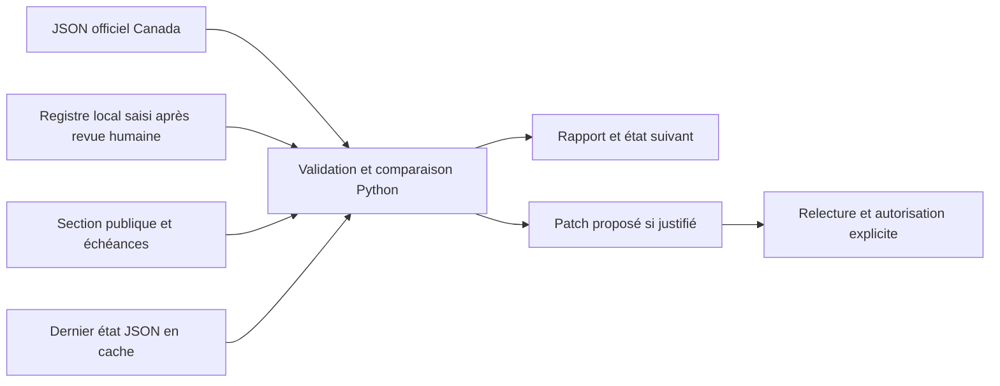

# Paris travel intelligence V2 — local review package

**GO pour une veille partielle assistée par une revue humaine.** La couverture
automatique des perturbations locales de Paris n'est pas établie. Le système
prépare des rapports ; il n'écrit pas sur GitHub et ne publie pas de nouvelles.
Le workflow planifié reste **non activé avant fusion**. L'autorisation finale du
propriétaire couvre le commit, le push de `feat/paris-travel-advisory-v1` et une
PR Draft vers `main`, après contrôle final. Elle ne couvre aucun merge,
déploiement, suppression de branche ou lancement manuel de la surveillance.

Worktree conservé : `feat/paris-travel-advisory-v1`,
`C:/Users/1995/AppData/Local/Temp/tripguidely-paris-travel-advisory-v1`.
Base V1 inchangée : `27c98abb1185da3364ecf7ac904e33117f729f99`.
Revue effectuée le 22 octobre 2026 à Toronto ; les essais réseau enregistrés
après minuit en Europe portent la date réelle du 23 octobre à Paris.

## 1. Architecture et inspection V1

V1 comportait quatre blocs éditoriaux, une documentation et des preuves QA,
sans collecteur, stockage d'état ou workflow de surveillance. Le workflow
existant `site-audit.yml` reste inchangé. Le contrat protégé
`docs/redesign-contract.md` et le baseline ont été lus, sans modification.

La section `#travel-updates`, son titre, son style et les trois liens sont
conservés. Son texte temporaire est archivé dans
[paris-v1-snapshot.html.txt](travel-intelligence/paris-v1-snapshot.html.txt) et les
deux observations V1 dans [paris-events.json](travel-intelligence/paris-events.json).
V1 n'avait enregistré qu'un jour de vérification : aucune heure n'a été inventée.
Ces fiches sont des `legacy_reference`, avec `verified_at: null` et sans demande
de publication. La documentation et les captures V1 restent disponibles.

La section publique devient une référence courte, datée et durable, avec les
trois sources officielles utiles et une invitation à les reconsulter avant chaque
trajet. Elle ne contient plus de fermeture temporaire susceptible de devenir
une alerte permanente. Les liens des guides n'affichent plus une ancienne date
de bulletin. Aucun CSS, JavaScript, widget ou dépendance navigateur ajouté.



Un seul script Python 3.12 utilise la bibliothèque standard et la base de fuseaux
IANA du runner Ubuntu. Aucune IA, base de données ou prestation payante nécessaire.
Le registre local sépare les quatre catégories : `demonstration`,
`transport_disruption`, `planned_works`, `general_advice`. Les mots du résumé
canadien ne servent qu'à orienter une revue, jamais à confirmer un événement.

## 2. Sources et autorisation d'accès

| Source | Traitement V2 | Justification et limite |
|---|---|---|
| Canada / Affaires mondiales Canada | Automatique : [index JSON officiel](https://data.international.gc.ca/travel-voyage/index-alpha-eng.json), entrée FR uniquement | Le [catalogue officiel](https://open.canada.ca/data/dataset/bef2ebb3-ca9a-485f-aaff-5dc36eb89426) publie cette ressource sous Licence du gouvernement ouvert – Canada. Deux essais réseau réussis. Résumé national et métadonnées, sans détail complet des événements parisiens. Attribution du producteur et URL dans le JSON de rapport. |
| RATP | [Référence manuelle](https://www.ratp.fr/infos-trafic) | HTML opérationnel, changements rapides ; aucune interface publique anonyme autorisée et stable n'a été validée ici. Les [mentions légales](https://www.ratp.fr/mentions-legales) réservent la reproduction et orientent les réutilisations vers l'open data. Aucun scraping planifié ajouté. |
| Préfecture de Police | [Référence manuelle](https://www.prefecturedepolice.interieur.gouv.fr/) | L'accès observé demande JavaScript/cookies. Aucun contournement ni connecteur automatisé ajouté. Les arrêtés, leur portée et leurs dates nécessitent une lecture directe. |
| France Diplomatie | [Référence manuelle](https://www.diplomatie.gouv.fr/en/services-to-foreigners/visiting-france) | La [FAQ officielle](https://www.diplomatie.gouv.fr/en/services/faq/voyage) propose un RSS pour les conseils aux Français voyageant à l'étranger ; ce flux ne constitue pas une couverture des incidents à Paris. |
| SNCF Connect | [Référence manuelle](https://www.sncf-connect.com/aide/informations-situation-perturbee) | Page pratique pour vérifier un train par numéro et date. Aucun flux anonyme adapté et autorisé n'a été validé pour les besoins locaux de cette mission. Cela ne signifie pas que toutes les données SNCF sont indisponibles. |
| Île-de-France Mobilités / PRIM | Option future, non connectée | L'[API Messages Info Trafic](https://prim.iledefrance-mobilites.fr/fr/apis/idfm-disruptions_bulk) décrit incidents, travaux, lignes et arrêts sous Licence Mobilité ; l'accès nécessite compte et jeton, avec CGU et quotas. Aucun compte, clé, secret ou coût engagé. |

Le catalogue Canada était consultable par son résultat indexé officiel ; certaines
ouvertures directes du portail retournaient 403. Le JSON publié était accessible.
Aucun accès protégé n'a été contourné. Le texte intégral des CGU PRIM et les
droits d'un éventuel compte restent à examiner avant une extension transport.

## 3. Fréquence et exécution

Le workflow proposé s'exécute à **05:23 UTC, heure fixe, chaque jour**, soit
06:23 à Paris en hiver et 07:23 en été. Ce décalage évite le début d'heure, sans dépendre d'un
réglage saisonnier du cron. `workflow_dispatch` permet une vérification urgente
sur `main`. En local, le script peut être lancé immédiatement. Il ne constitue
pas une couverture en temps réel ; le voyageur doit consulter l'opérateur avant
de se déplacer.

```text
python -B scripts/paris-travel-intelligence.py --output /tmp/paris-travel-run
python -B scripts/paris-travel-intelligence.py --state /tmp/paris-travel-run/state.json --output /tmp/paris-travel-next
python -B scripts/paris-travel-intelligence.py --check-public
python -B -m unittest discover -s tests -p test_paris_travel_intelligence.py -v
```

Sous Windows uniquement, Python peut nécessiter les données IANA `tzdata`.
Pour ces essais, `tzdata 2026.5` a été installé dans un dossier temporaire hors
dépôt et fourni par `PYTHONPATH`. Le workflow Ubuntu n'installe aucun paquet pip.
Ne pas remplacer Europe/Paris par un décalage fixe : le passage à l'heure d'hiver
du 25 octobre est testé.

Chaque exécution automatique effectue **une requête** vers le JSON autorisé,
sans retry, redirection, navigateur, cookies ou authentification. Délai réseau :
15 secondes par opération ; contrôle de durée de lecture à 30 secondes et limite
de 2 Mo ; chaque job est borné à cinq minutes. Un export datant de plus de
48 heures, un format inattendu ou une date incohérente impose une vérification.

GitHub ne garantit pas une exécution à la minute prévue : les tâches planifiées
peuvent être retardées ou abandonnées et ne s'exécutent que sur la branche par
défaut. Elles peuvent être désactivées après 60 jours d'inactivité d'un dépôt
public. Voir [la documentation des événements](https://docs.github.com/en/actions/reference/workflows-and-actions/events-that-trigger-workflows).
Il faut donc contrôler l'historique des exécutions ; un trou de plus de 36 heures
depuis la dernière collecte réussie est signalé au prochain lancement.

## 4. Comparaison, déduplication et rapports

Le collecteur ne compare aucun HTML. Il normalise les espaces et compare seulement
le niveau national, les indicateurs d'avis, le résumé de modification et les
métadonnées de publication de l'entrée France. Les autres pays et l'heure de
génération de l'export n'entraînent pas d'alerte.

Le rapport distingue changement de niveau/périmètre national, changement de résumé
à interpréter, simple changement de métadonnées et information inchangée.
Même un signal significatif ne devient jamais une manifestation ou fermeture
parisienne sans faits précis vérifiés par une personne.

Les empreintes par source et fiche permettent de séparer `new_findings` des points
toujours `pending_review`. Un échec ne remplace pas la dernière observation valide.
Le cache contient uniquement du JSON validé, jamais du code. Il n'est pas une base
durable : une disparition ou corruption impose une comparaison initiale explicite.
Voir [les limites du cache GitHub](https://docs.github.com/en/actions/reference/workflows-and-actions/dependency-caching).

Les sorties sont `report.md`, `report.json` et `state.json`. Lorsque des faits
humains précis justifient un changement, `proposal.patch` et `draft-pr.md` sont
ajoutés, sans être appliqués. Les anciens fichiers de proposition sont retirés
du dossier de sortie si la nouvelle exécution ne les justifie plus.
Le rapport garde les liens manuels en `verification required`, avec date de
consultation automatique nulle. Un échec réseau ne devient jamais un bilan rassurant.

Aucun email, issue, commentaire, PR ou notification personnalisée n'est envoyé.
Les rapports quotidiens gardent les points en attente sans les présenter comme
de nouvelles alertes. Les notifications habituelles d'échec Actions dépendent
des préférences GitHub du propriétaire et ne sont pas pilotées par ce script.

## 5. Vérification humaine et propositions

1. Ouvrir la source officielle ; vérifier date, lieu, cause et portée. Distinguer
   un conseil national, un incident local et des travaux programmés. Vérifier
   l'accès à l'attraction séparément, sans l'inférer d'une fermeture de station.
2. Remplir ou corriger la fiche JSON : source et URL exacte, catégorie, lieux,
   `confirmed_fact`, début ISO avec fuseau, fin connue ou `null`, heure réelle de
   vérification, nom du relecteur, pertinence pour le voyageur et texte anglais
   mesuré. Le texte anglais est écrit par la personne, jamais extrait de la page.
3. Mettre `review_status` à `human_verified` et choisir `review_due_at` au plus
   tard 24 heures après vérification. Une demande de proposition est explicite :
   `publication_requested: true`. Sans heure, début précis ou relecteur, pas de
   proposition publiable. Les doublons d'ID ou de faits doivent être consolidés.
4. Relancer le collecteur. Un échec de vérification interdit un nouvel avis public.
   Une proposition de retrait d'un ancien avis peut toutefois être préparée.
   Lire le rapport et le patch ; la proposition ne change que le bloc du hub.
5. Revérifier avant application locale, puis exécuter le contrôle d'échéance et
   l'audit officiel. Si un contrat protégé change, demander l'approbation exacte
   `kind`, `source`, `base_revision`, `before`, `after` ; ne pas toucher au baseline.
6. Après autorisation explicite seulement, ouvrir une Draft PR ciblée. Aucune
   fusion ou publication automatique n'est prévue. Le workflow n'a pas les droits
   d'ouvrir cette PR ou de modifier une branche.

Les fiches V1 ne satisfont pas l'étape 2 : leur heure de vérification n'est pas
connue. Le rapport réel final ne contient donc **aucune proposition de publication**.

## 6. Péremption et panne du planificateur

Le contenu public livré ici est durable : aucune alerte temporaire ne peut
devenir permanente si le planificateur ne fonctionne pas. Sa date désigne la
revue du texte de préparation, jamais un état de circulation en temps réel.
Le script ne fait pas avancer automatiquement cette date.

Un éventuel avis temporaire approuvé serait toujours affiché comme **dated
notice / snapshot**, avec vérification, début, fin connue ou mention explicite
d'une fin inconnue, échéance de revue et lien officiel. Il n'affirme rien sur les
conditions postérieures à sa vérification. L'échéance technique est le minimum
entre fin connue et date de revue ; une échéance écoulée ne vaut jamais réouverture.

Le contrôle hors ligne refuse un avis périmé, non géré ou incohérent avec le
registre relu. Il s'exécute sur PR, push pertinent, lancement manuel et quotidien.
Le job de surveillance est indépendant de ce contrôle : un refus pour péremption
n'empêche pas le rapport et le patch de retour à la référence durable.
Ce contrôle doit être rendu obligatoire dans les règles de revue avant de
s'appuyer sur lui comme condition de fusion ; aucun paramètre GitHub n'a été changé.

**Limite explicite :** sans autorisation de publication automatique, un avis
temporaire déjà publié ne peut pas être retiré à distance par cette veille.
Le retrait passe par une revue et une PR ; si GitHub est arrêté, le visiteur voit
encore la date et le caractère historique du snapshot. Pour cette raison, la
configuration livrée n'active aucun avis temporaire. Ne pas en publier si personne
n'assure la revue avant échéance. Aucun masquage JavaScript ne sert de garde-fou.

## 7. Sécurité et préservation

Permissions du workflow : `contents: read` uniquement. Les actions officielles
checkout/setup-python/cache/upload-artifact sont épinglées à des SHA complets
relevés sur leurs dépôts. Les credentials Git ne sont pas persistés. Seuls
schedule et dispatch du dépôt propriétaire sur `main` utilisent le cache ;
les PR n'ont aucun job de collecte ni sauvegarde d'état. Aucun secret nécessaire.
Les artefacts de revue expirent après 14 jours. Le workflow ne contient aucun
push, création de PR, déploiement ou merge.

URLs réseau fixes, redirections refusées, textes limités et échappés, schémas et
timestamps vérifiés, JSON à clés dupliquées refusé : rien de la source ni de
l'état restauré n'est exécuté. Les erreurs n'incluent ni corps de réponse ni
détail sensible. Une panne de configuration produit un rapport sans patch ni
nouvel état ; les anciens fichiers de proposition sont retirés.

Les quatre pages originales sont identiques à la base après retrait des seuls
blocs V1/V2 : head intégral, SEO, H1, JSON-LD, quartiers, hôtels, photos,
comparatifs, 21 ancres affiliées et leurs attributs/SubIDs, CTA et scripts.
Consentement, `affiliate_click`, CSS et JavaScript partagés restent exacts.
Londres, ses Hero et performances, Rome, New York, les autres destinations,
PR #49, les autres branches et worktrees n'ont pas été modifiés.

## 8. Fichiers et preuves

Ajouts V2 :

- `scripts/paris-travel-intelligence.py` : collecte, comparaison, échéances et
  propositions locales non appliquées.
- `.github/workflows/paris-travel-intelligence.yml` : validation et veille proposée.
- `tests/test_paris_travel_intelligence.py` : cas synthétiques hors réseau.
- `docs/travel-intelligence/paris-events.json` et `paris-v1-snapshot.html.txt`.
- Ce rapport et `docs/qa/paris-travel-intelligence-v2/` : rapports réels, état,
  contrôles, captures, texte de Draft PR proposé et audit officiel.

Modifications : les quatre pages `hotels/paris/`, dans les blocs ajoutés par V1
uniquement. La documentation V1 reçoit un lien vers ce rapport ; ses constats
historiques et ses preuves ne sont pas remplacés.

Validation locale :

- **30 tests synthétiques réussis** : nouvelle information, inchangée, périmée,
  inaccessible, dates ambiguës, doublons, travaux/manifestation, aucun événement,
  panne, rapport sans proposition, sécurité, état et changement d'heure.
- Deux essais réels du collecteur. Le dernier, à **03:34:52 le 23 octobre 2026
  à Paris**, retrouve la même entrée France : **zéro nouveau point**, aucune
  proposition de publication. Voir [rapport final](qa/paris-travel-intelligence-v2/final-check/report.md).
- 16 vues Chrome à 320/390/768/1440 px sur les quatre pages, sans débordement.
  Huit captures 390/1440 inspectées. Focus clavier, navigation des liens et
  fonctionnement sans JavaScript contrôlés. Contraste de la note : texte
  13,56:1, liens 4,80:1. Ce n'est pas un audit WCAG complet.
- 21 ancres affiliées originales conservées : 10 hub, 4 Luxury, 4 Family,
  3 Cheap. Clic représentatif par page : zéro événement sans consentement,
  exactement un avec consentement. Aucun partenaire ouvert, aucun accès tiers
  autorisé pendant les tests navigateur.
- Workflow validé par **actionlint 1.7.12**, exit 0, archive officielle vérifiée
  SHA-256 `6e7241b51e6817ea6a047693d8e6fed13b31819c9a0dd6c5a726e1592d22f6e9`.
  ShellCheck et Pyflakes non installés ; ces analyseurs facultatifs étaient désactivés.
- Résultat officiel final : [official-audit.json](qa/paris-travel-intelligence-v2/official-audit.json),
  exécuté une seule fois après finalisation du code, comparaison à la base V1
  exacte. Baseline et workflow d'audit inchangés. `git diff --check` contrôlé.

## 9. Coûts, activation et limites restantes

Coût de service externe : **0** ; aucune IA ni API payante utilisée. Deux jobs
Ubuntu courts par jour, une requête et quelques Ko de rapports/état ; estimation
de 60 à 120 minutes de runner par mois, à mesurer après autorisation. Les runners
standards des dépôts publics sont gratuits selon [GitHub Actions billing](https://docs.github.com/en/billing/concepts/product-billing/github-actions).
Les limites de stockage et les éventuels coûts d'un autre plan restent ceux du
compte ; aucun achat ni nouveau réglage facturable n'a été effectué.
Actionlint et tzdata utilisés pour QA restent hors dépôt.

Le commit, le push et la PR Draft ont reçu l'autorisation explicite du propriétaire
sous réserve de validation finale. **Une fusion dans `main` pourra activer la
planification automatiquement, selon les paramètres GitHub Actions du dépôt.**
La création de la PR ne vaut pas autorisation de fusion. Aucun lancement manuel,
activation de workflow ou changement des paramètres du dépôt ne sera effectué
avant fusion. Sur la PR, seul le job de validation hors ligne est éligible ; le
job `monitor` reste exclu. Aucune surveillance quotidienne ne tourne encore
pour ce projet. Après un merge ultérieurement autorisé, vérifier le premier lancement,
l'accès au JSON et la restauration de l'état dans les logs GitHub ; les essais
locaux et actionlint ne prouvent pas une exécution distante.

Le résumé national peut omettre un événement, et des changements intermédiaires
entre deux collectes peuvent être perdus. Une source inchangée ne confirme pas
l'absence de perturbation. Les interfaces ou CGU peuvent évoluer. La couverture
transport reste manuelle tant qu'un accès PRIM autorisé et ses données réelles
n'ont pas été validés. Décision pour une phase suivante : fournir un compte/jeton
PRIM existant autorisé et examiner ses CGU/quotas, ou conserver cette veille
partielle. Aucun de ces choix n'a été présumé.
